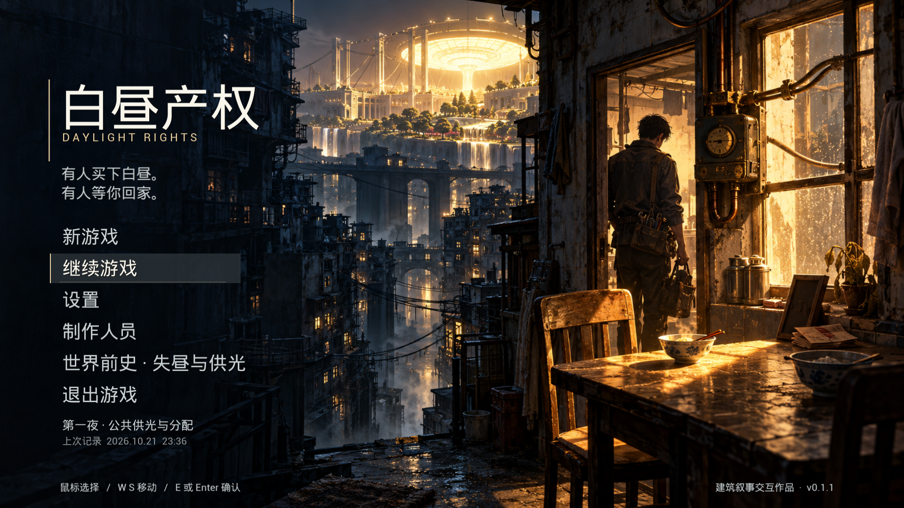
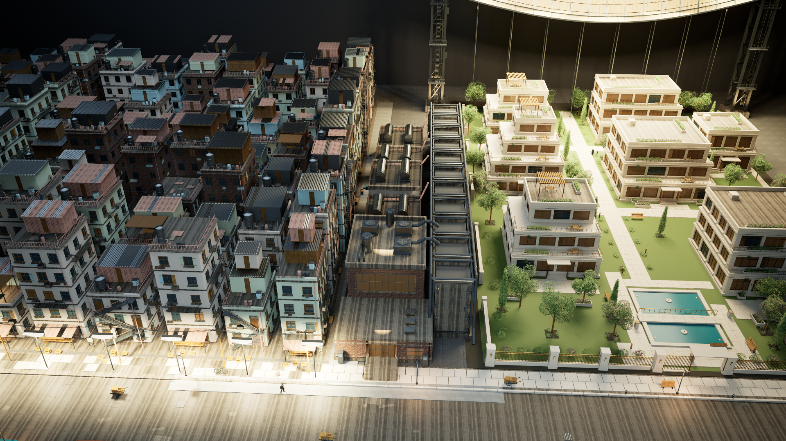
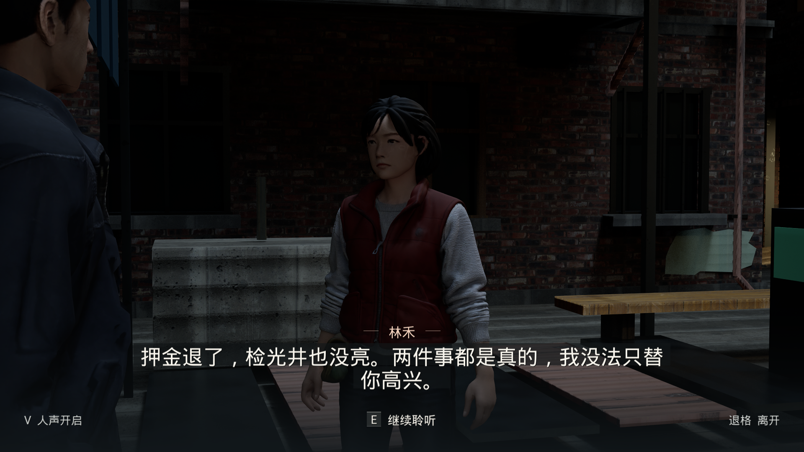

# 白昼产权 / Daylight Rights

基于 Unreal Engine 5.8 的建筑叙事游戏原型：当人工光照、供热和地址资格被捆绑出售，一个检修工怎样在家庭、邻里与制度之间作出选择？

[下载 v0.1.1 完整 Windows 游戏与展示册](https://github.com/Tyzxn0225/Daylight-power/releases/tag/v0.1.1)。完整解压游戏 ZIP，双击 `Windows/DaylightRights.exe`，无需安装 UE 编辑器。

本仓库是公开的**源码与设计作品集**。它包含项目自有 C++ 代码、配置、剧情数据和探索设计预览。原始人物、动画、声音、UE 二进制资源、存档和本机制作记录不在公开范围；**克隆本仓库不会直接得到完整可玩的工程**。



上图为独立程序的主页截图；封面是叙事美术，不能代表可游玩场景的画质。

## 当前功能

- 第三人称移动、普通慢跑与 Shift 快跑，E 键场景交互。
- 任务、打字机对白、人物关系、回看、存档与多种剧情结局。
- 右上角人物肖像地图、剧情方向提示与分区探索。
- 《没有登记的白昼》调查线：15 处现场、4 类小游戏、K 巡光手记。
- 透光套准、脉冲寻声、余热复算、封签查验；失败可退出重试，调查不凭空增加资源。
- 主页、设置、配乐、过场与带代表图像的成就系统代码。

## 目录

| 路径 | 内容 |
| --- | --- |
| `Source/DaylightRights` | 原生玩法、界面、叙事与导航 |
| `Config` | 可移植的项目配置 |
| `Content/BZ/StoryV27/campaign.json` | 自有主线剧情数据 |
| `Docs/Exploration/index.html` | 可操作的调查机制与地图设计预览 |
| `Docs/Releases/v0.1.1.md` | 完整游戏发布说明与验证边界 |
| `Tools/Build.ps1` | 通过参数指定引擎的本地编译入口 |
| `Tools/audit_public.py` | 暂存内容的隐私与产物检查 |

浏览器直接打开 `Docs/Exploration/index.html` 可以预览四类调查规则。该页面是设计原型，不能作为 UE 实机运行的验证证据。

## 编译与资源

需要合法安装的 Unreal Engine 5.8、Windows C++ 工具链，以及由资源权利人提供的非公开生产资源。设置 `UE_ROOT` 为本机的引擎安装根目录，再运行：

```powershell
./Tools/Build.ps1 -EngineRoot $env:UE_ROOT -Target Editor
```

运行完整关卡还需取得配套资源，并恢复原生产工程中的资源目录。本仓库不提供绕过素材授权的下载入口。详见 [资源与授权边界](THIRD_PARTY_NOTICES.md)。

## 版本状态

`v0.1.1` 为建筑毕业设计游戏初版，附完整可玩包。已完成从新游戏至片尾的连续步行路线、15 处调查路线与独立程序启动检查；人物表演、足部贴地和部分交互提示仍有原型局限。详细范围见 [验证记录](Docs/VALIDATION.md) 与 [发布说明](Docs/Releases/v0.1.1.md)。





## 许可

本仓库自有代码、剧情文本和文档使用 [MIT License](LICENSE)。Unreal Engine 与第三方人物、动画、字体、音频及素材保留各自许可，不能根据本仓库的 MIT 声明取得它们的再分发权。
